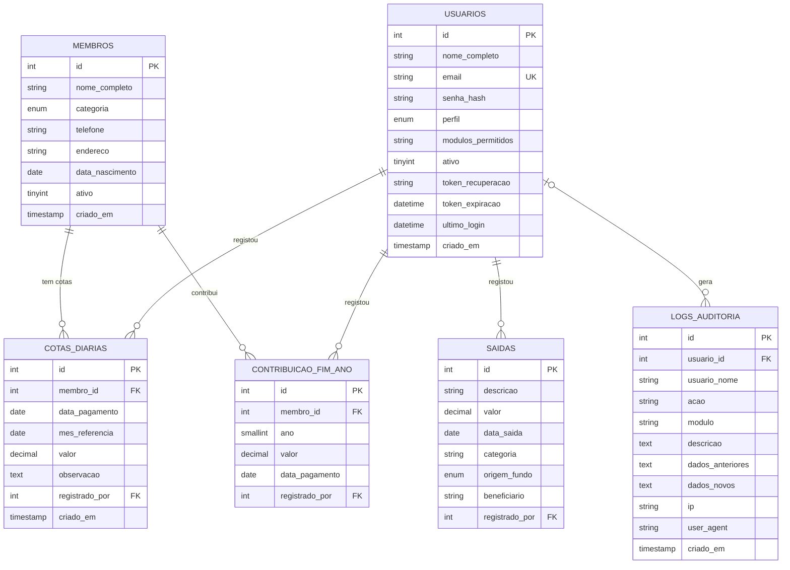
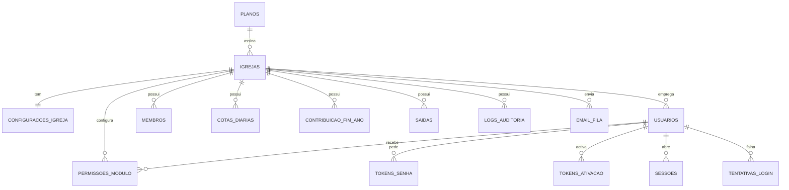

# Fase 1 — Análise, Mapa de Migração e MER

**Sistema:** `ipfva-gestao` / MonanaEclésia — I.P.F.V.A Calemba 2
**Objectivo:** transformação em SaaS multi‑igreja (PHP puro, MVC), sem perder funcionalidades
**Estado:** documento de análise — **nenhum código de produção foi alterado nesta etapa**
**Data:** 12/10/2026

---

## 1. Sumário executivo

O sistema actual é uma aplicação PHP + MySQL **procedural**, com 11 módulos, 6 tabelas e **51 páginas/endpoints** distribuídos por `modules/<nome>/*.php`. Cada página junta, no mesmo ficheiro, autenticação, SQL, regras de negócio e HTML. Não há camadas, não há testes e não há qualquer envio de email.

O repositório contém **duas versões em paralelo**:

| Versão | Onde | Estado |
|---|---|---|
| **Original procedural** | branch `main` → pasta `modules/` + `includes/` + `config/` | **Funcional.** É a fonte de verdade da lógica (11846 linhas) |
| **Refactor MVC a meio** | `controllers/` + `views/` (commit `13781b4`, feito por um bot) | **Quebrado.** Não corre: falta `models/`, falta `views/partials/`, 10 dos 12 controladores não passam sequer na verificação de sintaxe |

**Decisão tomada (D‑01):** a lógica de negócio é herdada de `modules/`; o HTML já extraído para `views/` é reaproveitado como matéria‑prima (com reparações); os `controllers/` actuais são descartados no arranque da Fase 5, ficheiro a ficheiro, à medida que cada módulo é migrado — o refactor actual não é uma base fiável.

### Números do inventário

| Métrica | Valor |
|---|---|
| Ficheiros PHP no total | 146 (25 295 linhas) |
| Ficheiros em `modules/` | 58 (11 846 linhas) |
| Controladores do refactor quebrado | 12 (6 562 linhas) |
| Vistas extraídas (29 delas com 1 byte = vazias) | 58 |
| Módulos funcionais | 11 |
| Tabelas de negócio | 6 |
| Páginas/endpoints a migrar | 51 (+ 7 ficheiros de apoio) |
| Envio de email hoje | **nenhum** |
| Protecção CSRF / rate‑limit hoje | **nenhuma** |

---

## 2. Achados críticos (bloqueadores e riscos)

| # | Achado | Impacto | Tratamento |
|---|---|---|---|
| A1 | `config/database.php` real **não existe no repositório** — está no `.gitignore` do projecto original e foi substituído por um stub `sqlite::memory:` | Não é possível correr nem testar localmente | `.env.example` + `config/database.php` a ler do `.env`; credenciais fornecidas por ti |
| A2 | A constante `ANO_INICIO_COTAS` é **usada 8 vezes e nunca definida** | Em PHP 8 lança `Error`; em 7.4 entra como string e corrompe a regra anual das cotas | Substituir por `configuracoes_igreja.inicio_cotas`, definido manualmente pelo pastor/admin (não inferido da data de criação da igreja; ver D‑06) |
| A3 | A cota mensal está **fixa em 1000 Kz dentro do código** (`getCotaMensal()`), em 5 sítios | Bloqueia multi‑igreja (cada igreja tem o seu valor) | Passa a `valor_cota` + `periodicidade_cota` (`mensal` ou `anual`), configuráveis pelo admin da igreja |
| A4 | A tabela `cotas_diarias` é **MyISAM** (documentado no próprio código) | MyISAM não suporta transacções **nem chaves estrangeiras** → impede o isolamento por `igreja_id` com FK | Migração `002` converte para **InnoDB** antes de adicionar FKs |
| A5 | O token de recuperação de senha é gravado **em texto simples** (`usuarios.token_recuperacao`) | Quem ler a BD assume contas | Tabela `tokens_senha` só com hash (SHA‑256), uso único, 60 min |
| A6 | A senha de recuperação é **escrita à mão pelo admin** noutro utilizador (`users/reset-password.php`) | Não há senha temporária nem obrigação de troca | Fluxo novo: senha temporária ou link de activação + `deve_trocar_senha` |
| A7 | **Zero protecção CSRF**, zero `session_regenerate_id`, zero cabeçalhos de segurança | Vulnerabilidades óbvias num SaaS multi‑inquilino | `CsrfMiddleware`, sessão endurecida, cabeçalhos no `Response` |
| A8 | `membros/index.php` e `registry/index.php` exigem perfil `admin` no topo, mas o `delete.php` do mesmo módulo também | Lógica de permissão inconsistente entre páginas do mesmo módulo | Unificar em `PapelMiddleware` + `permissoes_modulo` |
| A9 | Backups e exportações fazem `SHOW TABLES` e despejam **a base de dados inteira** | Num SaaS isto vazaria dados de todas as igrejas | Repositórios de backup passam a aceitar lista de tabelas com filtro `igreja_id` |
| A10 | O `_build/migrate.py` deixou `?>` órfãos dentro dos métodos (10 controladores) | Código posterior ao `?>` passa a ser emitido como HTML | Confirma que `controllers/` não é base fiável (D‑01) |
| A11 | Os comentários de `registry/recalcular-referencias.php` dizem *"dividindo um pagamento entre dois meses"*, mas `distribuirPagamentoPorMeses()` faz o **contrário** (registo inteiro no mês mais antigo) | Duas regras contraditórias no mesmo módulo: a ferramenta de correcção fragmenta, o registo diário não | **Decisão D‑02** (abaixo): alinhar a ferramenta com a regra do prompt (registo inteiro) |
| A12 | As vistas extraídas contêm `require_once '../../includes/topbar.php'` (caminho relativo inválido fora de `modules/`) | HTML extraído não funciona tal como está | Substituir por `View::partial('partials/topbar')` na migração de cada vista |
| A13 | Identidade textual fixa no código: "I.P.F.V.A Calemba 2", "Calemba 2", rodapé "Igreja Pentecostal Fonte da Vida Angola", "João 14:6" | Cada igreja tem o seu nome | Passam para `configuracoes_igreja` (nome, subtítulo, rodapé, versículo, logótipo) |

---

## 3. Inventário funcional (módulos, páginas e permissões)

Legenda de permissões actuais: **admin** = só perfil `admin`; **módulo** = via `requireModuleAccess('<chave>')` (admin ou gestor com o módulo atribuído); **—** = qualquer sessão iniciada.

### 3.1 Autenticação (`modules/auth/`)

| Página | O que faz | Guarda |
|---|---|---|
| `login.php` | Formulário dividido (marca à esquerda / formulário à direita), login AJAX com modal de progresso; grava `user_id`, `user_nome`, `user_email`, `user_perfil`, `user_modulos` na sessão; actualiza `ultimo_login`; audita `login` (sucesso e falha) | — |
| `logout.php` | Audita `logout`, destrói a sessão | sessão |
| `forgot-password.php` | Gera `bin2hex(random_bytes(32))`, grava **em texto simples** com `token_expiracao`; **não envia email nenhum** (mostra o link no ecrã) | — |
| `reset-password.php` | Valida token + expiração, grava novo `senha_hash`, limpa o token | — |

### 3.2 Módulos de negócio

| Módulo | Chave de permissão | Páginas | Notas |
|---|---|---|---|
| **Dashboard** | `dashboard` | `index.php` | 9 queries: membros activos, por categoria, cotas do mês (2 comparações), membros em falta no mês, série de 6 meses, cotas de hoje, último membro/cota, login recente |
| **Membros** | `members` | `index, add, edit, view, delete, toggle-status, historico-pagamentos` | CRUD + soft‑delete; `criado_em`; 4 categorias (`mama`, `papa`, `jovem`, `crianca`); filtros client‑side em JS |
| **Registo Diário de Cotas** | `registry` | `index, add, edit, delete, generate-pdf, recalcular-referencias` | **Núcleo financeiro**; regras RN01–RN06 abaixo; exclusão só do dia corrente |
| **Listas** | `lists` | `index, mamas, papas, jovens, generate-pdf, functions` | Grelhas domingo‑a‑domingo do mês, selo "Quitado (pago em …)" |
| **Contribuição de Fim de Ano** | `year_end` | `index, register, remove, toggle-status, get-saldo, generate-pdf` | Contribuições por `ano`; alimenta o fundo `contribuicoes` das saídas |
| **Saídas/Despesas** | `expenses` | `index, add, edit, delete` | Fundos: `cotas` \| `contribuicoes`; saldo por fundo |
| **Relatórios** | `reports` | `index` (financeiro), `annual`, `expenses`, `export-excel`, `generate-pdf`, `generate-expenses-pdf` | Excel em `.xls` (HTML table), PDF por Dompdf |
| **Utilizadores** | `users` (**só admin**) | `index, add, edit, delete, toggle-status, reset-password` | Perfis: `admin`, `gestor`; módulos do gestor numa lista CSV em `modulos_permitidos` |
| **Auditoria** | `audit` (**só admin**) | `index, generate-pdf` | Filtros por utilizador/módulo/acção; máx. 500 registos |
| **Backups** | `backups` (**só admin**) | `index, export-sql, export-excel, xlsx-writer` | Despeja **todas** as tabelas (A9) |
| **Perfil** | sempre permitido | `index` | Edita nome/email e troca a própria senha (exige senha actual) |

### 3.3 Infra partilhada

| Ficheiro | Papel |
|---|---|
| `config/url.php` | `APP_BASE` (`/monana-eclesia`), `url()`, `asset()`, `redirect()`, `esconder_php()` (normaliza rotas legadas) |
| `config/session.php` | `isLoggedIn`, `checkLogin`, `getModulosAtribuiveis`, `podeAcessarModulo`, `requireModuleAccess`, `getUrlPosLogin` |
| `config/bootstrap.php` | Carrega url/session/database + `vendor/autoload.php`; `db()` |
| `includes/header.php` | `<!DOCTYPE>`, fontes, **CSS injectado inline com `readfile()`** (não `<link>`) — decisão de hospedagem partilhada |
| `includes/sidebar.php` | Menu com `podeAcessarModulo()`; define `rotaAtual()` |
| `includes/topbar.php` | Dropdown do utilizador, modal de logout, menu mobile |
| `includes/footer.php`, `footer-scripts.php` | Rodapé com marca e ministério |
| `includes/pdf-theme.php` | `pdfLogoDataUri()`, `pdfCabecalho()`, `pdfBrandCss()` — **cabeçalho fixo "I.P.F.V.A · Calemba 2"** |
| `includes/modal-historico-pagamentos.php` | Modal partilhado do histórico de cotas do membro |
| `paginas-erro/404.php` | 404 personalizado com a identidade |
| `.htaccess` | URLs amigáveis, 301 de `/modules/...`, esconde `.php`, `ErrorDocument`, bloqueia `config|includes|core|controllers|views|_build|vendor` |

---

## 4. Esquema de dados actual (reconstruído a partir das queries)

> Não existe `CREATE TABLE` em nenhum ficheiro do repositório e `config/database.php` está fora do repo. O esquema abaixo foi **reconstruído por análise** de todas as leituras/escritas (INSERT/UPDATE/SELECT) e está marcado com o que é evidência directa e o que é inferência.

### 4.1 Tabelas

**`membros`** — evidência: INSERT, UPDATE, 24 SELECT distintos

| Coluna | Tipo inferido | Evidência |
|---|---|---|
| `id` | INT PK AI | `WHERE id = :id` |
| `nome_completo` | VARCHAR | INSERT + ORDER BY |
| `categoria` | ENUM('mama','papa','jovem','crianca') | `SUM(CASE WHEN categoria='mama'…)` |
| `telefone` | VARCHAR NULL | INSERT |
| `endereco` | VARCHAR NULL | INSERT |
| `data_nascimento` | DATE NULL | INSERT (`?: null`) |
| `ativo` | TINYINT(1) | `WHERE ativo = 1`, `toggle-status` |
| `criado_em` | TIMESTAMP | `date('d/m/Y', strtotime($membro['criado_em']))` |

**`usuarios`** — evidência: INSERT, UPDATE, 11 SELECT distintos

| Coluna | Tipo inferido | Evidência |
|---|---|---|
| `id` | INT PK AI | |
| `nome_completo` | VARCHAR | INSERT |
| `email` | VARCHAR (**único global**) | `SELECT id FROM usuarios WHERE email = :email` |
| `senha_hash` | VARCHAR(255) | `password_hash(..., PASSWORD_DEFAULT)` |
| `perfil` | ENUM('admin','gestor') | INSERT (`'gestor'` por defeito), `<option>` |
| `modulos_permitidos` | VARCHAR NULL (CSV) | INSERT; `explode(',', …)` |
| `ativo` | TINYINT(1) | `toggle-status` |
| `token_recuperacao` | VARCHAR(64) NULL (**texto simples**) | A5 |
| `token_expiracao` | DATETIME NULL | `token_expiracao > NOW()` |
| `ultimo_login` | DATETIME NULL | `UPDATE … SET ultimo_login = NOW()` |
| `criado_em` | TIMESTAMP | `ORDER BY criado_em DESC` |

**`cotas_diarias`** — **MyISAM** (A4) — evidência: 24 SELECT distintos

| Coluna | Tipo inferido | Evidência |
|---|---|---|
| `id` | INT PK AI | |
| `membro_id` | INT (**sem FK — MyISAM**) | JOIN com `membros` |
| `data_pagamento` | DATE | `DATE(data_pagamento) = :data` |
| `mes_referencia` | DATE (sempre dia 01) | `sprintf('%04d-%02d-01')` |
| `valor` | DECIMAL(10,2) | `SUM(valor)`, `round(...,2)` |
| `observacao` | TEXT NULL | INSERT |
| `registrado_por` | INT NULL → `usuarios.id` | LEFT JOIN |
| `criado_em` | TIMESTAMP | `ORDER BY criado_em DESC` |

**`contribuicao_fim_ano`** — evidência: INSERT + 8 SELECT distintos

| Coluna | Tipo inferido |
|---|---|
| `id` | INT PK AI |
| `membro_id` | INT |
| `ano` | SMALLINT (filtro por ano em todas as queries) |
| `valor` | DECIMAL(10,2) |
| `data_pagamento` | DATE (`CURDATE()` no INSERT) |
| `registrado_por` | INT NULL |

**`saidas`** — evidência: INSERT, UPDATE, 10 SELECT distintos

| Coluna | Tipo inferido |
|---|---|
| `id` | INT PK AI |
| `descricao` | VARCHAR |
| `valor` | DECIMAL(10,2) |
| `data_saida` | DATE |
| `categoria` | VARCHAR (valores livres; `SELECT DISTINCT categoria`) |
| `origem_fundo` | ENUM('cotas','contribuicoes') |
| `beneficiario` | VARCHAR NULL |
| `registrado_por` | INT NULL |
| `criado_em` | TIMESTAMP (inferido) |

**`logs_auditoria`** — evidência: INSERT (9 colunas)

| Coluna | Tipo inferido |
|---|---|
| `id` | INT PK AI |
| `usuario_id` | INT NULL |
| `usuario_nome` | VARCHAR (desnormalizado de propósito) |
| `acao` | VARCHAR (`login`, `logout`, `criar`, `editar`, `excluir`, `desativar`, `resetar_senha`, …) |
| `modulo` | VARCHAR (`members`, `registry`, `users`, `backups`, `auth`, …) |
| `descricao` | TEXT |
| `dados_anteriores` / `dados_novos` | TEXT (JSON via `json_encode`) |
| `ip` | VARCHAR(45) |
| `user_agent` | VARCHAR NULL |
| `criado_em` | TIMESTAMP |

### 4.2 MER actual



*As relações são lógicas: em MyISAM não existem chaves estrangeiras reais. As ligações a `usuarios` são `LEFT JOIN` — `registrado_por`/`usuario_id` podem ser NULL.*

---

## 5. Regras de negócio a preservar (contrato de comportamento)

Estas regras são o que os testes de regressão da Fase 7 vão validar.

| ID | Regra | Implementação actual | Onde |
|---|---|---|---|
| **RN01** | **Mês de referência = mês mais antigo em dívida.** No modo mensal, um pagamento novo é atribuído ao mês mais antigo, a partir do início manual definido para as cotas (e, nos anos seguintes, desde Janeiro), cujo total ainda seja `< valor_cota`. Se todos estiverem quitados, usa o período corrente | `distribuirPagamentoPorMeses()`, `calcularProximoMesReferencia()` | `lists/functions.php` |
| **RN02** | **O pagamento não é dividido.** Se 2000 Kz entrarem e a cota mensal for 1000, grava‑se **um único registo** no mês mais antigo (com os 2000 Kz); os meses seguintes aparecem quitados *por adiantamento*. No modo anual, a mesma regra aplica‑se ao período anual configurado | `distribuirPagamentoPorMeses()` devolve sempre 1 elemento | `lists/functions.php` |
| **RN03** | **Quitação por saldo acumulado.** No modo mensal, `total_pago` (soma desde o início aplicável do ano até ao mês) ÷ cota = nº de meses quitados; `quitado ⇔ meses_quitados >= mês`. O modo anual usa o valor e a unidade anual configurados | `calcularSaldoMembro()`, `verificarStatusMes()` | `lists/functions.php` |
| **RN04** | **Reinício anual no modo mensal.** Dívidas de anos anteriores são ignoradas: a contagem começa em Janeiro do ano corrente, excepto no primeiro ano, em que começa no mês de início escolhido pelo pastor/admin | `$meses_deveria = (int) $mes`, `$ano_inicio = max($ano_atual, ANO_INICIO_COTAS)` | `lists/functions.php` |
| **RN05** | **Valor e periodicidade da cota por igreja.** O admin define o valor em Kz e se a cota é mensal ou anual; `valor_cota` representa o montante de cada período | `getCotaMensal()` + 5 usos | A3 |
| **RN06** | **Domingos.** As listas mostram os domingos do mês como colunas de pagamento; um pagamento conta na coluna da **data real** de pagamento (não do `mes_referencia`) | `getDomingosDoMes()`, `getPagamentosMembro()` | `lists/functions.php` |
| **RN07** | **Exclusão de cota só no dia corrente.** Registos de dias passados não podem ser apagados | `registry/delete.php` | — |
| **RN08** | **Membro com histórico não é apagado, é desactivado.** Sem cotas → `DELETE`; com cotas → `ativo = 0` | `members/delete.php` | — |
| **RN09** | **Módulos do gestor.** Admin tem tudo; gestor só os módulos em `modulos_permitidos`; `profile` sempre; `users`/`audit`/`backups` só admin | `podeAcessarModulo()`, `requireModuleAccess()` | `config/session.php` |
| **RN10** | **Auditoria universal.** Toda a acção sensível grava log com utilizador, nome, acção, módulo, descrição, dados antes/depois, IP e user‑agent; falha de log **não** interrompe a operação | `registrarLog()` | `audit/functions.php` |
| **RN11** | **Fundos separados.** Saídas usam `origem_fundo` ∈ {`cotas`, `contribuicoes`}; o saldo é calculado por fundo | `expenses/*`, `year-end/*` | — |
| **RN12** | **Fundo de fim de ano.** Contribuições por `ano`; saídas com `origem_fundo='contribuicoes'` e `YEAR(data_saida)=ano` consomem esse fundo | `year-end/generate-pdf.php` | — |
| **RN13** | **Troca da própria senha exige a senha actual** e confirmação; email de utilizador é único | `profile/index.php` | — |
| **RN14** | **Formatação AO:** moeda `1.250,00 Kz`, datas `dd/mm/aaaa`, interface em pt‑AO | `number_format($v, 2, ',', '.')`, `date('d/m/Y')` | todo o sistema |
| **RN15** | **Início manual dos módulos financeiros.** Criar uma igreja não inicia automaticamente cotas nem contribuições; o pastor/admin escolhe o período de início. Se escolher Junho, não se contabilizam períodos anteriores a Junho | Nova configuração no módulo da igreja | requisito confirmado pelo utilizador |

### ⚠️ Contradição detectada (A11 / decisão D‑02)

`registry/recalcular-referencias.php` é uma **ferramenta de correcção de dados antigos** que reaplica a regra RN01/RN02 aos registos já existentes. Os seus comentários dizem que *"divide um pagamento entre dois meses quando necessário"* e o código (`calcularRedistribuicao` → `orig_ids` com mais de 1 elemento) confirma que **fragmenta** um pagamento em vários registos — o oposto de RN02.

**Decisão a aplicar:** alinhar a ferramenta com RN02 (um registo por pagamento real, no período mais antigo em dívida). A regra foi definida no requisito original: o pagamento real permanece inteiro; a ferramenta de recálculo não deve fragmentá‑lo. Qualquer correcção de histórico será validada antes de ser aplicada aos dados existentes.

---

## 6. Autenticação e segurança: o que existe vs. o que a Fase 1 exige

| Requisito | Hoje | Acção |
|---|---|---|
| Login por email + senha | ✅ (`password_verify`) | manter, com mensagem genérica |
| Hash de senha | ✅ `PASSWORD_DEFAULT` (bcrypt) | passar a **Argon2id** quando disponível + `password_needs_rehash` |
| `session_regenerate_id` no login | ❌ | implementar |
| Cookies `HttpOnly` / `Secure` / `SameSite` | ❌ | implementar |
| Expiração por inactividade | ❌ | implementar (configurável) |
| Terminar todas as sessões | ❌ | tabela `sessoes` (+ versão de sessão) |
| Recuperação de senha com token | ⚠️ existe, mas **em texto simples** e sem email | `tokens_senha` com **hash**, uso único, 60 min |
| Email de recuperação | ❌ (mostra o link no ecrã) | `MailService` + fila `email_fila` |
| Activação de conta / primeiro acesso | ❌ | `tokens_ativacao` + `deve_trocar_senha` |
| Força bruta | ❌ | `tentativas_login` + bloqueio temporário + auditoria |
| CSRF | ❌ | `CsrfMiddleware` + `csrf_field()` |
| Verificação de email | ❌ | `email_verificado_em` |
| 2FA (TOTP) | ❌ | deixar previsto, **fora da Fase 1** |
| Cabeçalhos de segurança / HTTPS forçado | ❌ | no `Response` + `.htaccess` |
| Auditoria de login/logout/reset/utilizadores/igrejas/impersonação | ⚠️ login/logout/reset parcial | completar |

---

## 7. Identidade visual a preservar

### 7.1 Ficheiros e tokens

| Elemento | Fonte | Nota |
|---|---|---|
| Tema completo | `assets/css/monana-theme.css` (547 linhas) | injectado **inline** por `includes/header.php` via `readfile()` — manter (funciona sem acesso a ficheiros estáticos por rewrite) |
| CSS legado | `assets/css/monana.css`, `style.css` | presentes mas não referenciados no fluxo actual |
| Paleta | dourado `#c99a2e` (gradiente `#e3b94f → #b08020`), castanho `#3a271a` / `#2a1b12`, marfim `#fbf8f1` | tokens `--*` no tema |
| Tipografia | Cormorant Garamond (títulos) + Inter (interface) | Google Fonts |
| Ícones | Font Awesome 6.5 (CDN) | |
| Logótipo | `assets/img/logo.png`, `logo-mark.png`, favicons | |
| Classes estruturais | `app`, `sidebar`, `sb-brand`, `sb-nav`, `sb-label`, `sb-item`, `sub`, `main`, `topbar`, `content`, `page-head`, `stat-card`, `metric-card`, `panel`, `btn-primary`, `grid-stats`, `footer-note`, `modal-overlay`, `modal-box` | usadas nas vistas extraídas |
| Login | `.auth`, `.auth-brand`, `.auth-panel`, `.auth-card`, `.logo`, `.mark-sm`, `.tagline`, `.legal`, `.field`, `.toggle-eye`, `.check` | layout dividido |
| PDFs | `includes/pdf-theme.php` (legado) e `app/Views/pdf/layout.php` (MVC) | os geradores MVC de Cotas, Listas, Fim de Ano, Relatórios e Auditoria usam o layout comum; ver o estado/gates em `docs/fase-05-membros.md` |
| Emails | `app/Views/emails/*` | frame HTML reutilizável, texto em pt-AO e escaping dos dados dinâmicos |

### 7.2 Textos a parametrizar por igreja

`I.P.F.V.A Calemba 2` (títulos `<title>` e cabeçalhos), `I.P.F.V.A · Calemba 2` (PDF), `Calemba 2` (sidebar, rodapé), `Igreja Pentecostal Fonte da Vida Angola — Calemba 2 · Plataforma MonanaEclésia` (rodapé), `João 14:6`.

---

## 8. Mapa de migração (página antiga → novo)

Convenções: rota nova em português, sem `.php`; **301 permanentes** das rotas actuais para as novas (preserva bookmarks). Todas as consultas passam a receber `igreja_id`.

### 8.1 Autenticação e conta

| Página antiga | Novo controlador::acção | Rota nova | Service | View |
|---|---|---|---|---|
| `modules/auth/login.php` | `Auth\LoginController::index` / `::entrar` | `/login` | `AuthService` | `layouts/auth` + `auth/login` |
| `modules/auth/logout.php` | `Auth\LoginController::sair` | `/logout` | `AuthService` | — |
| `modules/auth/forgot-password.php` | `Auth\SenhaController::pedir` | `/recuperar-senha` | `AuthService` + `MailService` | `auth/recuperar-senha` |
| `modules/auth/reset-password.php` | `Auth\SenhaController::redefinir` | `/redefinir-senha/{token}` | `AuthService` | `auth/redefinir-senha` |
| — *(novo)* | `Auth\AtivacaoController::mostrar` / `::definir` | `/ativar/{token}` | `AuthService` | `auth/ativar` |
| — *(novo)* | `Auth\SenhaController::trocarObrigatoria` | `/primeiro-acesso` | `AuthService` | `auth/trocar-senha` |

### 8.2 Superadmin (novo)

| Novo controlador | Rotas | Service |
|---|---|---|
| `Superadmin\DashboardController::index` | `/superadmin` | métricas globais (nº igrejas, activas, suspensas, utilizadores, membros) |
| `Superadmin\IgrejaController::index/criar/ver/suspender/reativar/reenviarEmail` | `/superadmin/igrejas`, `/nova`, `/{id}`, `/{id}/suspender`, `/{id}/reativar`, `/{id}/reenviar-email` | `ProvisionamentoIgrejaService`, `MailService` |
| `Superadmin\PlanoController::index/criar/editar` | `/superadmin/planos` | — |
| *(opcional)* `Superadmin\IgrejaController::impersonar` | `/superadmin/igrejas/{id}/entrar-como` | `AuthService` + auditoria + aviso no topo |

### 8.3 Módulos da igreja

| Módulo | Páginas antigas | Controller / rotas canónicas | Repository / service |
|---|---|---|---|
| Dashboard | `dashboard/index.php` | `DashboardController::index` · `/painel` | `DashboardRepository` + `DashboardService` |
| Membros | `members/index,add,edit,view,delete,toggle-status` | `MembroController` · `/membros`, `/membros/novo`, `/membros/{id}`, `/membros/{id}/editar` | `MembroRepository` + `MembroService` |
| Histórico de pagamentos | `members/historico-pagamentos` | Continua 503 sem fallback; aguarda integração e validação dos módulos financeiros | — |
| Cotas | `registry/index,add,edit,delete,generate-pdf` | `CotaController` · `/cotas`, `/cotas/novo`, `/cotas/{id}/editar`, `/cotas/pdf` | `CotaDiariaRepository` + `CotaService` |
| Recálculo de referências | `registry/recalcular-referencias` | Continua 503; reescrita histórica aguarda pré-visualização e reversão aprovadas | — |
| Listas | `lists/index,mamas,papas,jovens,generate-pdf` | `ListaController` · `/listas`, `/listas/mamas`, `/listas/papas`, `/listas/jovens`, `/listas/criancas`, `/listas/pdf` | `ListaRepository` + `ListaService` |
| Saídas | `expenses/index,add,edit,delete` | `SaidaController` · `/saidas`, `/saidas/nova`, `/saidas/{id}/editar` | `SaidaRepository` + `SaidaService` |
| Fim de Ano | `year-end/index,register,remove,toggle-status,get-saldo,generate-pdf` | `FimAnoController` · `/contribuicoes-fim-de-ano`, `/contribuicoes-fim-de-ano/saldo`, `/contribuicoes-fim-de-ano/pdf` | `ContribuicaoFimAnoRepository` + `FimAnoService` |
| Relatórios/PDF | `reports/index,annual,expenses,export-excel,generate-pdf,generate-expenses-pdf` | `RelatorioController` · `/relatorios`, `/relatorios/anual`, `/relatorios/despesas`, `/relatorios/pdf`, `/relatorios/pdf-despesas`, `/relatorios/exportar-excel` (CSV) | `RelatorioRepository` + `RelatorioService` |
| Utilizadores | `users/index,add,edit,delete,toggle-status,reset-password` | `UtilizadorController` · `/utilizadores`, `/utilizadores/novo`, `/utilizadores/{id}/editar` | `UsuarioRepository` + `UsuarioService` |
| Auditoria | `audit/index,generate-pdf` | `AuditoriaController` · `/auditoria`, `/auditoria/pdf` | `AuditRepository` + `AuditoriaConsultaService` |
| Backups | `backups/index,export-sql,export-excel` | `BackupController` · `/copias-de-seguranca` e POST `/copias-de-seguranca/exportar` (JSON; sem SQL/restauro) | `BackupRepository` + `BackupService` |
| Perfil | `profile/index.php` | `PerfilController` · `/perfil` | `UsuarioRepository` + `PerfilService` |
| Configurações | *(novo)* | `ConfiguracaoController` · `/configuracoes` | `ConfiguracaoRepository` + `ConfiguracaoService` |


### 8.4 Services e responsabilidades

| Service | Responsabilidade | Regras |
|---|---|---|
| `CotaService` | Cálculo da referência mensal/anual móvel, saldo e quitação por adiantamento; recálculo histórico permanece bloqueado | **RN01–RN07** |
| `AuthService` | Login, logout, tokens, sessões, primeiro acesso, força bruta | secção 6 |
| `ProvisionamentoIgrejaService` | Criação de igreja + admin + configurações + permissões + fila de email **numa transacção** | secção 9 do prompt |
| `MailService` | Renderiza templates, enfileira, envia (SMTP/Log), actualiza estado e tentativas | `MailerInterface` |
| `AuditoriaService` | Escrita de logs com igreja, utilizador, IP, data | RN10 |
| `RelatorioService` | Agregações financeiras (cotas, fundos, categorias, séries mensais) | RN11–RN12 |
| `BackupService` | Exportação JSON tenant-scoped, sem credenciais nem tokens; SQL/restauro indisponíveis | A9 |
| `ListaService` | Grelhas de domingos, selos de quitação | RN06 |

---

## 9. MER alvo (multi‑tenant)

### 9.1 Novas tabelas de plataforma



### 9.2 Tabelas novas (colunas essenciais)

| Tabela | Colunas essenciais |
|---|---|
| **`igrejas`** | `id`, `plano_id` FK, `nome`, `slug` UK, `email_admin`, `telefone`, `cidade`, `estado` ENUM(`pendente`,`activa`,`suspensa`), `criada_em`, `suspensa_em`, `motivo_suspensao` |
| **`planos`** | `id`, `nome`, `limite_membros`, `limite_utilizadores`, `preco_kz`, `ativo`, `criado_em` |
| **`configuracoes_igreja`** | `igreja_id` PK/FK, `nome_exibicao`, `subtitulo`, `rodape`, `versiculo`, `logo_path`, `valor_cota`, `periodicidade_cota` ENUM(`mensal`,`anual`), `inicio_cotas` DATE NULL, `inicio_contribuicoes` DATE NULL, `moeda` (`AOA`), `dias_expiracao_sessao` |
| **`permissoes_modulo`** | `id`, `usuario_id` FK, `igreja_id` FK, `modulo`, `permitido` TINYINT — UK(`usuario_id`,`modulo`) |
| **`tokens_senha`** | `id`, `usuario_id` FK, `token_hash` CHAR(64) UK, `expira_em`, `usado_em`, `criado_em`, `ip` |
| **`tokens_ativacao`** | `id`, `usuario_id` FK, `token_hash` UK, `expira_em`, `usado_em`, `criado_em` |
| **`sessoes`** | `id` CHAR(64) PK, `usuario_id` FK, `igreja_id`, `ip`, `user_agent`, `ultima_actividade`, `criada_em` |
| **`tentativas_login`** | `id`, `email`, `ip`, `sucesso` TINYINT, `tentada_em` — índices em (`email`,`tentada_em`) e (`ip`,`tentada_em`) |
| **`email_fila`** | `id`, `igreja_id` NULL, `destinatario`, `assunto`, `corpo_html`, `template`, `estado` ENUM(`pendente`,`enviado`,`falhou`), `tentativas`, `erro`, `agendado_para`, `enviado_em`, `criado_em` |
| **`usuarios`** (alterada) | + `igreja_id` NULL (NULL = superadmin), `papel` ENUM(`superadmin`,`admin_igreja`,`pastor`,`tesoureiro`,`secretario`,`lider`), `deve_trocar_senha`, `email_verificado_em`, `versao_sessao` |
| **6 tabelas de negócio** (alteradas) | + `igreja_id` INT NOT NULL, índice, FK → `igrejas(id)`, engine **InnoDB** |

### 9.3 Regras de integridade

- `usuarios.email` — **único global** (login único, mais simples).
- `igrejas.slug` — único; usado no caminho/URL da igreja.
- Unicidade por inquilino: `membros` (`igreja_id`,`nome_completo`,`telefone`) apenas como índice de pesquisa (não bloqueia homónimos).
- **Toda** leitura/escrita de dados de igreja passa `igreja_id`; acessos por `id` validam `igreja_id` **na mesma consulta** (anti‑IDOR).
- `igreja_id` vem sempre da sessão (`TenantMiddleware`), nunca de formulário, URL ou cookie.
- A criação da igreja não inicia automaticamente as cotas nem as contribuições: o pastor/admin define o período de início em cada módulo; antes dessa configuração não há períodos devidos.
- Se o início for definido para Junho, o cálculo começa em Junho — não se criam dívidas retroactivas dos meses anteriores.
- Superadmin: `igreja_id IS NULL` e acesso restrito a `/superadmin` por `PapelMiddleware`.

---

## 10. Estrutura de pastas alvo

```
/app
  /Controllers  /Superadmin  /Auth  /Igreja
  /Models  /Repositories  /Services  /Middleware  /Core
  /Views  /layouts  /auth  /superadmin  /igreja  /partials  /pdf  /emails
/config        app.php  database.php  mail.php          (lêem o .env)
/database      /migrations  001_… 002_…   /seeds
/public        index.php  .htaccess  /assets
/routes        web.php
/storage       /logs  /backups  /emails
_legado/       código procedural antigo, arquivado e desligado (ver D‑03)
.env.example   README.md  composer.json  docs/
```

**Decisão D‑03:** o código antigo é mantido em `_legado/` (arquivado, inacessível por HTTP) **apenas** até a Fase 6 validar a migração de dados; depois é removido do repositório. Nada fica a correr em paralelo.
**Decisão D‑04:** rotas novas em português + 301 das rotas actuais. Nenhuma página antiga fica acessível depois de migrada.
**Decisão D‑05:** `membros.categoria`, `saidas.origem_fundo` e `usuarios.perfil` mantêm os valores actuais; `perfil` é migrado para `papel` (`admin`→`admin_igreja`, `gestor`→`tesoureiro` por defeito, ajustável na Fase 6).

**Hospedagem confirmada:** InfinityFree no plano gratuito. A instalação fica dentro de `htdocs`; o `index.php` da raiz apenas encaminha para o único front controller `public/index.php`. O `.htaccess` e uma guarda PHP bloqueiam acesso directo às pastas internas e a `.env`, SQL e logs. Não se dependerá de ficheiros fora de `htdocs`.

---

## 11. Ferramentas de verificação disponíveis neste ambiente

⚠️ **Este ambiente não tem interpretador PHP nem MySQL.** Não posso executar a aplicação nem correr PHPUnit aqui.

O que **posso** fazer, e já está montado:

| Ferramenta | Uso |
|---|---|
| **Parser PHP real (tree-sitter-php)** | validar a sintaxe de cada ficheiro que escrever (foi assim que detectei os 9 controladores quebrados) |
| **Auditorias estáticas em Python** | verificar: nenhum `SQL` fora de `Repositories`; todo o método de repositório menciona `igreja_id`; nenhum `igreja_id` vindo de `$_POST`/`$_GET`; todos os formulários POST com `csrf_field()` |
| **Testes de isolamento e regressão** | escritos como *scripts PHP autónomos* (sem PHPUnit e sem Composer extra) para correres localmente ou por FTP, já que não há CLI no servidor |

Repor o parser neste ambiente (a `.venv` não é versionada):

```bash
python3 -m venv .venv && .venv/bin/pip install tree_sitter tree_sitter_php
```

O que **não** posso garantir aqui, e que tens de executar do teu lado antes de cada fase: `php -l` nos ficheiros novos, aplicação das migrações e os testes de integração contra a base de dados real.

Os testes de RN01–RN04 (`CotaService`) serão escritos com um duplo de repositório em memória, para poderem correr sem base de dados.

---

## 12. Plano das fases seguintes

| Fase | Entregável | Como valido |
|---|---|---|
| **2. Núcleo MVC** | `app/Core` (Autoload PSR‑4, Router, Request, Response, Controller, View, Database, Session, Validator, Config), `.env.example`, `config/*.php`, `routes/web.php`, front controller, `database/migrations/001…003`, `Response` com cabeçalhos de segurança | Sintaxe + `php -l` teu; smoke test da rota `/login` |
| **3. Auth + Superadmin** | `AuthService`, `MailerInterface` (`SmtpMailer`, `LogMailer`), fila `email_fila`, `ProvisionamentoIgrejaService`, painel Superadmin, planos, CSRF, rate limit, auditoria | Testes de auth, provisionamento e reset; fila visível e reenvio |
| **4. Layouts + identidade** | `Views/layouts/{app,auth,superadmin}.php`, parciais partilhadas, `Views/pdf`, `Views/emails` | Smoke test autónomo das vistas e comparação visual quando houver runtime web disponível |
| **5. Migração módulo a módulo** | Membros → Cotas → Listas → Saídas → Fim de Ano → Relatórios/PDF → Utilizadores → Auditoria → Backups → Perfil → Dashboard → Configurações, cada um com `CotaService`/repositórios filtrados | Auditoria estática + testes de regressão por módulo |
| **6. Migração de dados** | Script idempotente: cria igreja 1 (I.P.F.V.A Calemba 2), `igreja_id = 1` nos registos, converte MyISAM→InnoDB, cria superadmin, migra `perfil`→`papel` | Execução dupla (prova de idempotência) + reversão documentada |
| **7. Testes e segurança** | Isolamento entre igrejas (ID directo, listas, relatórios, PDF, Excel, backup), regressões RN01–RN14, revisão OWASP | Relatório de resultados |
| **8. Documentação** | `README` (instalação, `.env`, migrações, SMTP, deploy FTP na InfinityFree) | Revisão de quem instala |

### Progresso da Fase 5

A sequência completa da Fase 5 — **Membros → Cotas → Listas → Saídas → Fim de Ano → Relatórios/PDF → Utilizadores → Auditoria → Backups → Perfil → Dashboard → Configurações** — tem implementação MVC documentada em `docs/fase-05-membros.md`. Os gates de todos os módulos permanecem `false` por omissão até à Fase 6, porque as tabelas de negócio ainda não receberam nem tiveram validado o `igreja_id` real. O histórico completo de pagamentos de membros e o recálculo de referências antigas continuam 503, sem fallback procedural, por dependerem de integração financeira e correcção segura de dados históricos. D‑06 foi decidido e aplicado ao código: a periodicidade anual usa ciclos móveis de 12 meses ancorados na data inicial manual da igreja, sem reinício no ano civil. Nenhuma migration, consulta de produção ou alteração de dados foi executada.

---

## 13. Decisões registadas e pontos pendentes

| ID | Decisão ou ponto | Estado e regra |
|---|---|---|
| **D‑02** | A ferramenta `recalcular-referencias` deve dividir pagamentos ou alinhar com RN02 (**registo inteiro** no período mais antigo)? | **Decidido:** alinhar com RN02; não fragmentar um pagamento real. |
| **D‑06** | Como definir o valor, o arranque e a fronteira anual das cotas/contribuições? | **Decidido:** o admin define o valor e periodicidade da cota (`mensal`/`anual`); pastor/admin escolhe manualmente o período de início de cada módulo. Não se infere o arranque de `igrejas.criada_em`; se o pastor seleccionar Junho, o cálculo começa em Junho. Na igreja 1, manter inicialmente 1000 Kz/mês e mapear o início histórico na Fase 6. No modo anual, cada período é um ciclo móvel de 12 meses ancorado na data de início definida para a igreja; não reinicia em Janeiro/ano civil. |
| **D‑07** | Qual o alvo de alojamento? | **Decidido:** InfinityFree gratuito; ficheiros dentro de `htdocs`, pastas internas protegidas e front controller único em `public/index.php`, chamado pela entrada da raiz. |

*(D‑01, D‑03, D‑04 e D‑05 já estão decididas acima e seguem a opção mais simples.)*
